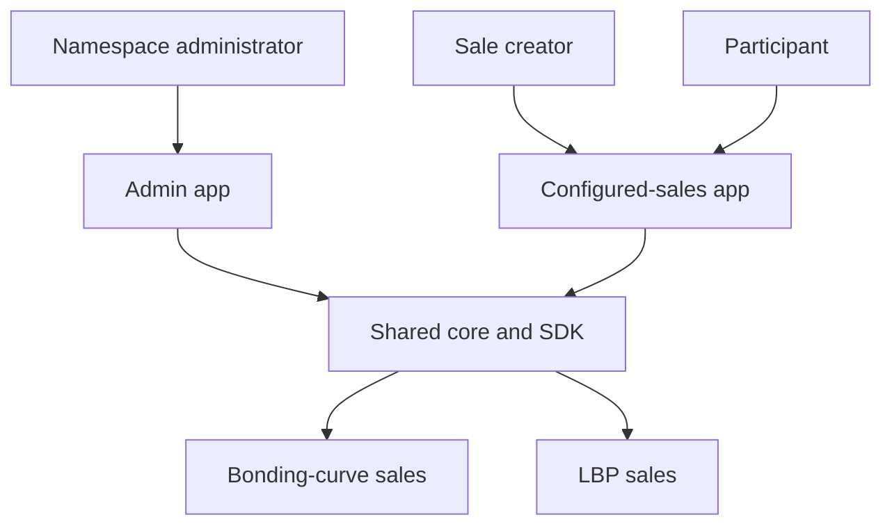

# Logos launchpad

Token sales on the Logos Execution Zone (LEZ), with two ways to set the sale price: a bonding curve and a liquidity bootstrapping pool (LBP).

The target product lets creators launch sales and participants trade through clear, reusable tools. Independent namespaces give launchpad operators their own administration, fee settings and treasury. A future shared core can support both launch mechanisms without making them use the same sale rules.

This repository contains an imported PoC baseline and design documentation. The baseline keeps the root curve crates, CLI, methods and on-chain program IDLs. It does not implement the full production specification. The LBP state machine, shared core and QML apps remain future work.

## Two sale mechanisms

| Mechanism | How it works | When it ends |
| --- | --- | --- |
| Bonding curve | Reserve-based pricing changes as participants buy or sell. Selling back is available when the sale mode permits it. | When all sale tokens are purchased, or at an optional expiry. |
| LBP | Pool weights change over a chosen time schedule to support price discovery. Fixed-price mode is also planned. | At the scheduled end time. |

## Product view

Two Basecamp QML mini-apps serve different users. The admin app handles namespace administration only. The configured-sales app handles creator and participant flows within a selected namespace. Both use a shared core module; it is not a third mini-app. App placement does not grant or merge authority roles.

This is the planned product view. The QML apps and shared core are future work. Participants will be able to inspect sales, get quotes, choose slippage limits and view trade history. The [private-route design](docs/architecture/private-participation.md) combines deshield, trade and return of received tokens, unused input and unused gas in one transaction. Actual fees are excluded, and pool state and trade effects remain public. Runtime implementation, wallet support and allowlist proofs still need verification.

## RFPs and proposals

| Product | Request | Proposal |
| --- | --- | --- |
| Bonding-curve launchpad | [RFP-015](https://github.com/logos-co/rfp/blob/master/RFPs/RFP-015-bonding-curve-launchpad.md) | [Proposal #118](https://github.com/logos-co/rfp/issues/118) |
| LBP launchpad | [RFP-016](https://github.com/logos-co/rfp/blob/master/RFPs/RFP-016-lbp-launchpad.md) | [Proposal #119](https://github.com/logos-co/rfp/issues/119) |

## Read more

- [Product goals and use cases](docs/product/prd.md)
- [Curve overview](docs/product/curve-contract.md)
- [Namespace, custody, and fee contract](docs/product/namespace-fee-contract.md)
- [Architecture and interfaces](docs/architecture/system.md)
- [Private participation and recovery](docs/architecture/private-participation.md)
- [Creation and private-route sequences](docs/architecture/sequence-diagrams/README.md)
- [Repository baseline and planned layout](docs/architecture/repository-layout.md)
- [Workspace commands](docs/architecture/workspace-guide.md)
- [Domain terms](CONTEXT.md)
- [Plain-English glossary](docs/glossary.md)
- [Architecture decisions](docs/adr/README.md)
- [Agent instructions](AGENTS.md)

## License

Project code is licensed under [MIT](LICENSE). Third-party dependencies retain their own licenses.
