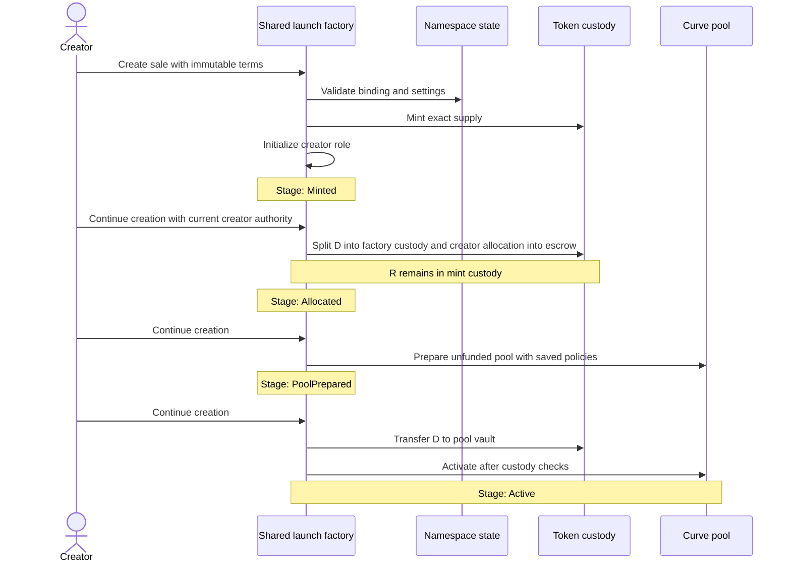

# Create a curve pool

This is the implemented staged actor flow, not a live app workflow. Local signed setup has [execution evidence](../workspace-guide.md#execution-and-evidence-limits). The configured-sales app and LP-0021 wallet integration remain planned.

The namespace must exist. The creator supplies typed sale terms, including `D`, `R`, the separate creator allocation and supported policies. [ADR 0031](../../adr/0031-shared-launch-factory.md) owns shared setup; [ADR 0008](../../adr/0008-curve-allocation-and-close.md) owns curve allocation rules.

Each stage is atomic with its child calls. The workflow spans transactions and is not atomic as a whole. A prepared pool cannot trade before funding. Continuations recheck authority and custody. Namespace administration does not grant creator rights, and the administrator does not approve each stage.

The factory retains pool ownership. Saved graduation terms govern post-close payouts. See [settlement and graduation](../../adr/0020-settlement-and-graduation.md) and [ending rules](../../adr/0025-sale-closing.md). Failed-setup recovery remains an [evidence gap](../workspace-guide.md#execution-and-evidence-limits).
