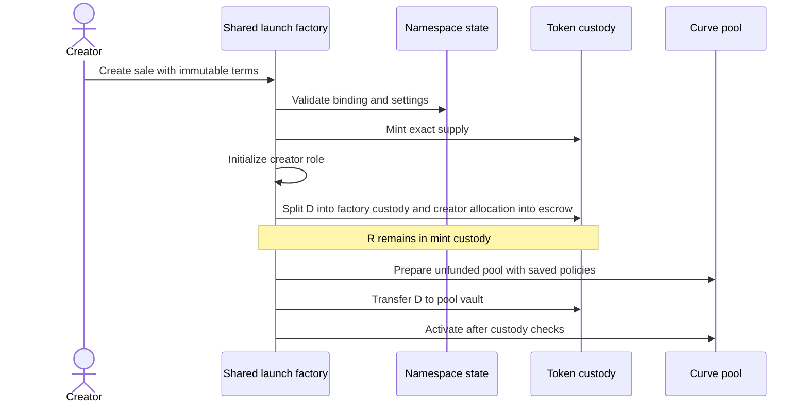

# Create a curve pool

This diagram shows one creator-signed transaction for a fresh public curve sale. The configured-sales app and LP-0021 wallet integration remain planned. See the [workspace guide](../workspace-guide.md#execution-and-evidence-limits) for execution evidence.

The namespace must exist. The creator supplies typed sale terms, including `D`, `R`, the separate creator allocation and supported policies. [ADR 0031](../../adr/0031-shared-launch-factory.md) owns shared setup; [ADR 0008](../../adr/0008-curve-allocation-and-close.md) owns curve allocation rules.

Success leaves a funded pool. Failure rolls back sale state, token changes and sale events. Namespace administration does not grant creator rights, and the administrator does not approve creation.

The factory retains pool ownership. Saved graduation terms govern post-close payouts. See [settlement and graduation](../../adr/0020-settlement-and-graduation.md) and [ending rules](../../adr/0025-sale-closing.md).
