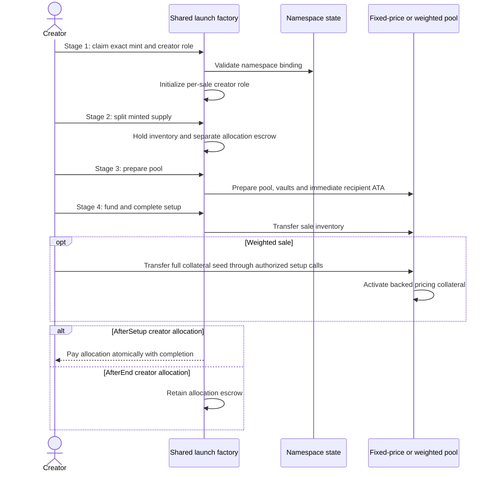

# Create a fixed-price or weighted sale pool

Both engines implement four setup stages. Local signed tests cover fresh setup, funding failures and both allocation-release choices; see [execution limits](../workspace-guide.md#execution-and-evidence-limits). This diagram describes program calls, not a working QML/wallet flow.

The namespace must exist. The creator signs the initial claim and supplies typed immutable terms, inventory and optional creator allocation. Fixed-price terms require a positive exact smallest-unit price. Weighted terms require a collateral seed and a valid normalized weight schedule. See [fixed-price setup](../../adr/0032-fixed-price-lbp-setup.md), [weighted setup](../../adr/0031-shared-launch-factory.md) and [time/weight bounds](../../adr/0026-lbp-clock-and-poke.md).

Each stage is atomic, but the four-transaction workflow is not. Authority, saved terms and custody are rechecked. Final setup can fund before a scheduled start. [ADR 0032](../../adr/0032-fixed-price-lbp-setup.md) owns immediate-start and trusted-clock rules.

Fixed-price setup records zero collateral; donations remain surplus under [ADR 0033](../../adr/0033-fixed-price-lbp-recorded-collateral.md). Weighted setup must transfer the full creator seed; a prior donation cannot replace it. Neither engine has curve `R` custody. `AfterEnd` payout and settlement are implemented, subject to the selected [ending policy](../../adr/0025-sale-closing.md), authority and duplicate-payout protection.
