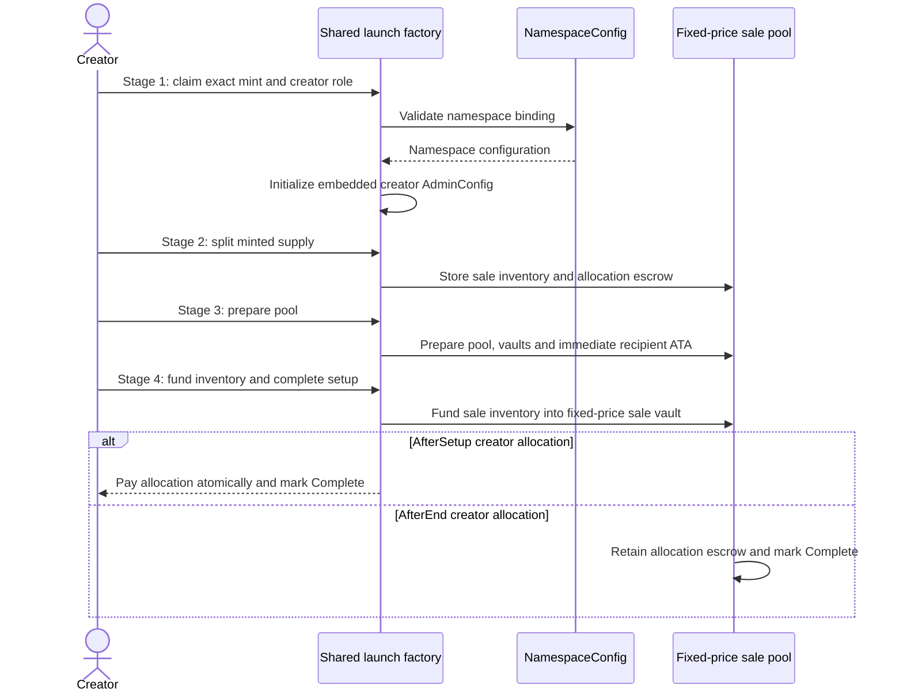

# Create a fixed-price sale pool

This diagram describes the implemented four-transaction fixed-price sale setup. Locked local verification passed using development receipts; real proofs and deployment readiness remain pending. See [ADR 0032](../../adr/0032-fixed-price-lbp-setup.md).

## Preconditions

- The creator signs the sale claim and can fund the positive sale inventory.
- The target namespace has its curve-owned canonical `NamespaceConfig`.
- The creator supplies a positive exact smallest-unit price, a positive sale inventory, an optional creator allocation, an immutable `AfterSetup` or `AfterEnd` release choice and a valid schedule.
- The pool has zero recorded collateral before final setup; unsolicited transfers remain surplus under [ADR 0033](../../adr/0033-fixed-price-lbp-recorded-collateral.md).

## Notes

The creator signer initializes the embedded creator role in the same claim. Namespace administration stays separate from that role. `StartNow` uses trusted creation time. A scheduled start cannot precede trusted current time, and the end must follow the selected start. Late final setup keeps the configured end and requires current time before it.

Each stage is atomic. The workflow spans four transactions. Final setup can fund the fixed-price sale vault before a scheduled start. `AfterSetup` pays the creator allocation only after successful final funding. `AfterEnd` retains the already placed allocation in escrow; later settlement or payout is future work. The fixed-price sale setup does not use curve `R` allocation or curve factory custody.

## Out of scope

This flow does not add buys, sells, weighted accounting, fees, close, end payout, end hooks, delayed settlement, cancellation or expired-recovery handlers, private fixed-price sale flows, allowlists, full SDK or CLI flows. Event indexing, wallet integration and the final account schema need separate implementation and review.
