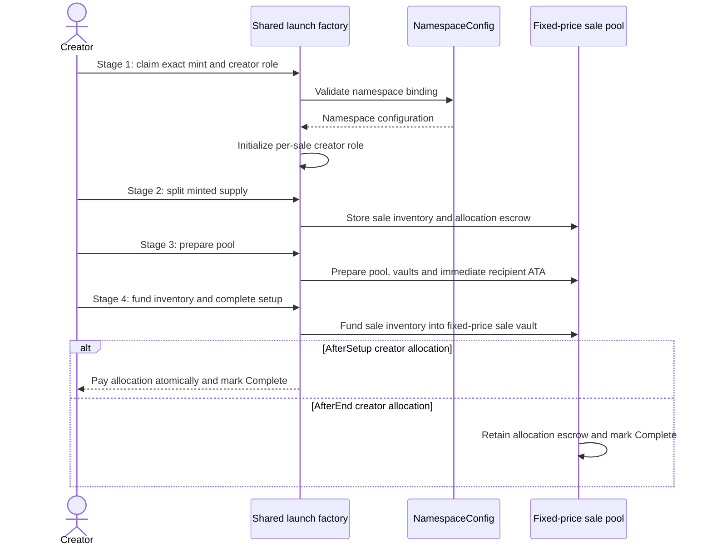

# Create a fixed-price sale pool

This diagram describes the four-transaction fixed-price sale setup. The implementation is migrated and local actor host and guest-build checks passed. Setup execution, real proofs and deployment readiness remain pending. See [ADR 0032](../../adr/0032-fixed-price-lbp-setup.md).

## Preconditions

- The creator signs the sale claim and can fund the positive sale inventory.
- The target namespace has its curve-owned canonical `NamespaceConfig`.
- The creator supplies a positive exact smallest-unit price, a positive sale inventory, an optional creator allocation, an immutable `AfterSetup` or `AfterEnd` release choice and a valid schedule.
- The pool has zero recorded collateral before final setup; unsolicited transfers remain surplus under [ADR 0033](../../adr/0033-fixed-price-lbp-recorded-collateral.md).

## Notes

The creator signer initializes the creator role in the same claim. Namespace administration stays separate from that role. Immediate start saves the supplied timestamp as a clock lower bound; it does not read and save current time. Scheduled starts and activation use separate trusted-clock checks. See [ADR 0032](../../adr/0032-fixed-price-lbp-setup.md) for the time rules.

Each stage is atomic. The workflow spans four transactions. Final setup can fund the fixed-price sale vault before a scheduled start. `AfterSetup` pays the creator allocation only after successful final funding. `AfterEnd` retains the already placed allocation in escrow until its separate claim is eligible. Setup saves the common payout terms under [ADR 0020](../../adr/0020-settlement-and-graduation.md), without adopting curve factory custody.

## Out of scope

This diagram covers setup only. Trading, fees, ending, common manual or adapter payouts and separate allocation claims are defined in the linked ADRs. Delayed settlement, cancellation or expired-recovery handlers, private fixed-price sale flows and full SDK or CLI flows remain outside this flow. Event indexing, wallet integration and the final account schema need separate implementation and review.
