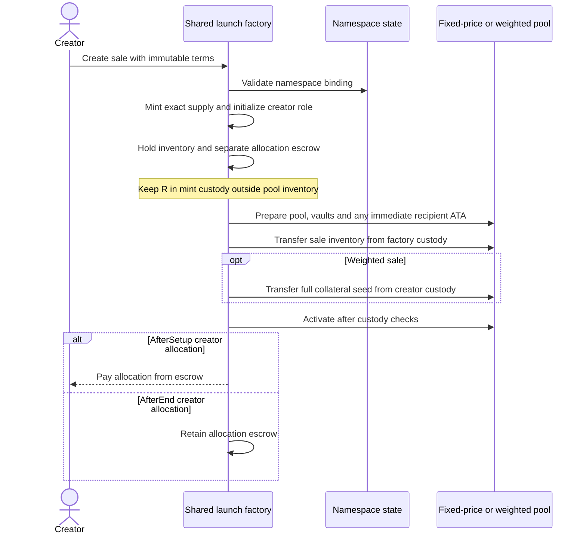

# Create a fixed-price or weighted sale pool

This diagram shows one creator-signed transaction for a fresh public fixed-price or weighted sale. See the [workspace guide](../workspace-guide.md#execution-and-evidence-limits) for execution evidence.

The namespace must exist. The creator supplies typed immutable terms, inventory and optional creator allocation. Fixed-price terms require a positive exact price in smallest units. Weighted terms require a collateral seed and a valid normalized weight schedule. See [fixed-price setup](../../adr/0032-fixed-price-lbp-setup.md), [weighted setup](../../adr/0031-shared-launch-factory.md#shared-setup) and [time and weight bounds](../../adr/0026-lbp-clock-and-poke.md).

Success leaves a funded pool, which can wait for a scheduled start. Failure rolls back sale state, token changes and sale events.

Fixed-price setup records zero collateral; donations remain surplus under [ADR 0033](../../adr/0033-fixed-price-lbp-recorded-collateral.md). Weighted setup must transfer the full creator seed; a prior donation cannot replace it. `AfterEnd` payout and settlement are implemented, subject to the selected [ending policy](../../adr/0025-sale-closing.md), authority and duplicate-payout protection.
