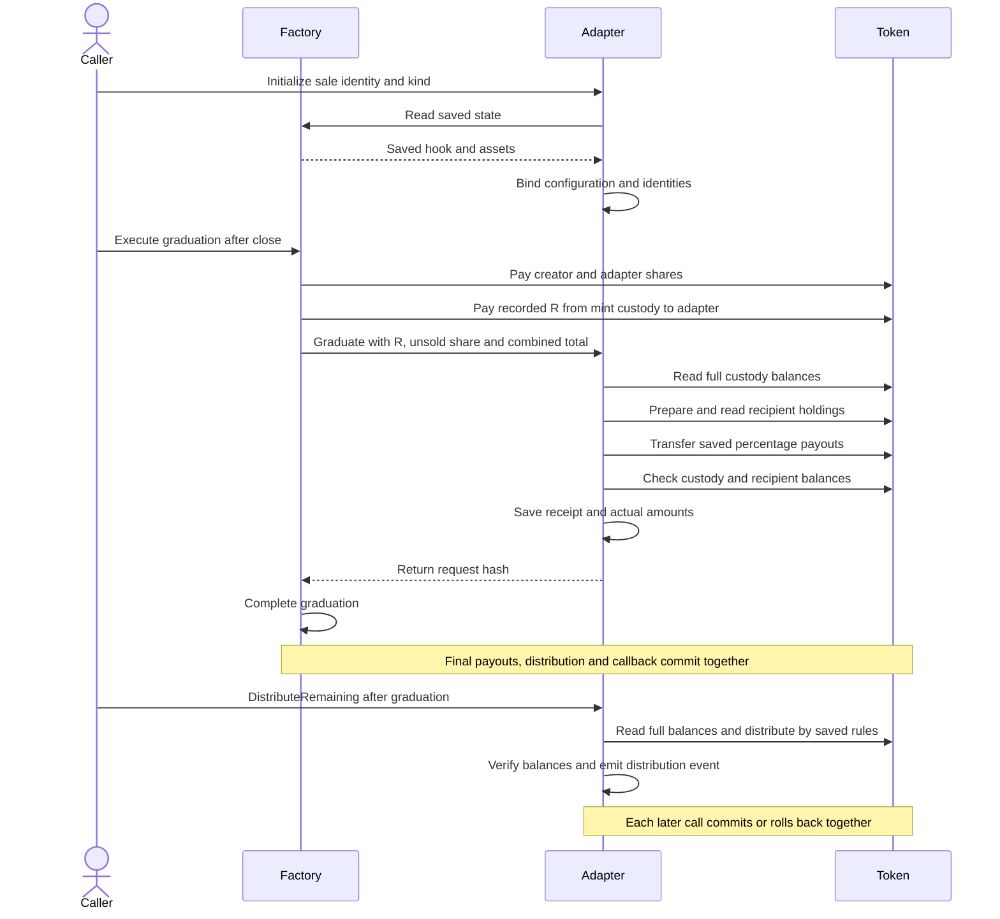

# Distribution adapter flow

[ADR 0036](../../adr/0036-graduation-adapter-delivery.md) defines configuration, rounding and custody rules. [ADR 0020](../../adr/0020-settlement-and-graduation.md) defines factory settlement.

