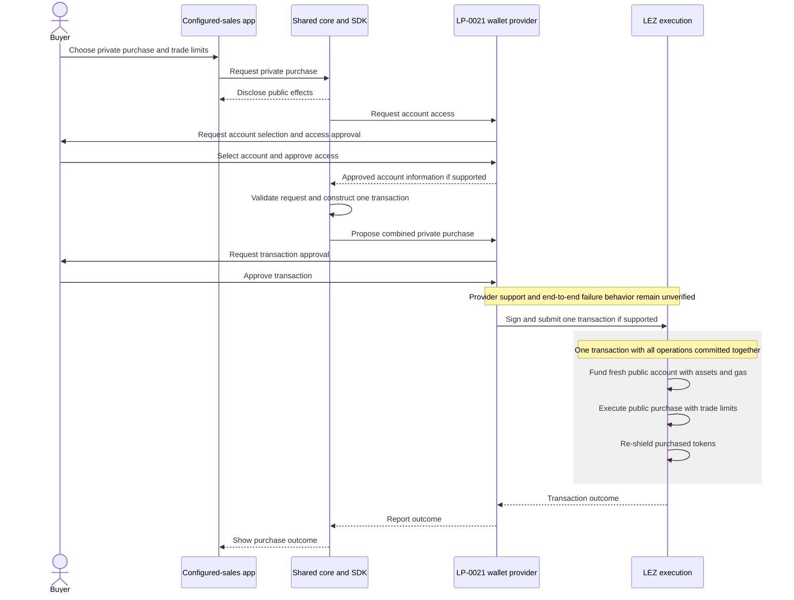

# Private purchase

This is the planned SDK-managed purchase route. Deshield, trade and re-shield execute in one transaction. The imported curve-buy guest provides baseline code for this flow; provider integration and end-to-end failure behavior remain unverified. Private curve sells, private LBP buys and allowlist proofs still need specifications. Public pool state and trade effects remain visible.

## Preconditions

- The buyer has selected the private route and explicit trade limits.
- The sale is open and the requested trade can pass current on-chain checks.
- LP-0021 provider integration awaits SDK development; its final API and support for the combined private transaction remain unavailable for verification.

## Notes

The public-account funding step includes deshield. Internal calls run in order within the same transaction. The required behavior is for all operations to commit together or fail without a partial trade or re-shield result. Verify this on the target platform; this diagram is not evidence that it works.

There is no separately committed purchase followed by a re-shield retry in this design. Failure handling, unknown submission outcomes and retry safety still require verification. No automatic refund, reversal or recovery flow is specified.

The SDK owns transaction construction and the app-facing flow. The wallet provider owns account access, user approval, signing and submission. The shared core does not hold user keys.

## Open details

LP-0021 is the selected provider integration; its final API and support for the combined private transaction remain unverified. Private curve sells, private LBP buys and allowlist proofs require separate specifications. See [ADR 0018](../../adr/0018-private-participation.md) and [ADR 0029](../../adr/0029-wallet-integration.md).
