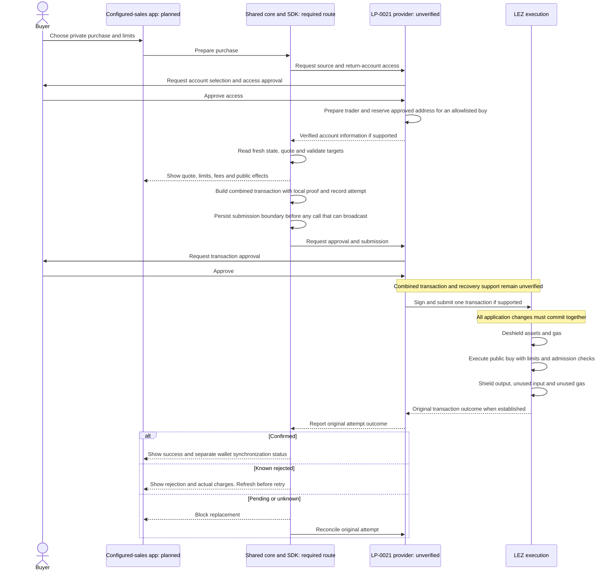

# Private purchase

This is a required route, not a verified implementation. Compatible private holdings, complete returns and wallet support remain missing. The [private participation contract](../private-participation.md) owns account, fee, privacy, progress and recovery requirements. Public admission has separate [signed evidence](../allowlist-proof.md#public-execution-evidence).

Before preparation, select the private route and explicit trade limits. The sale must permit the buy. The provider must verify control and asset compatibility for sources and private return targets. An allowlisted buy needs membership for the actual public trader; see [enrollment](../allowlist-proof.md).

A late required return failure must reject purchase application changes. Actual fees are excluded from returns and may still be charged after rejection. There is no separately committed purchase followed by a shielding retry or separate-transaction fallback.

The diagram does not select provider method names. Persist the submission boundary before an operation that can both request approval and broadcast. A lost result after that boundary is unknown until evidence establishes the outcome. Do not switch traders or repeat a confirmed purchase to recover wallet synchronization.

For required tests and remaining platform work, see [acceptance scenarios](../private-participation.md#acceptance-scenarios) and [evidence still required](../private-participation.md#evidence-still-required). The [older platform research](../../research/private-route-transaction-patterns.md) records earlier call-budget and return gaps; it does not establish current runtime limits.
