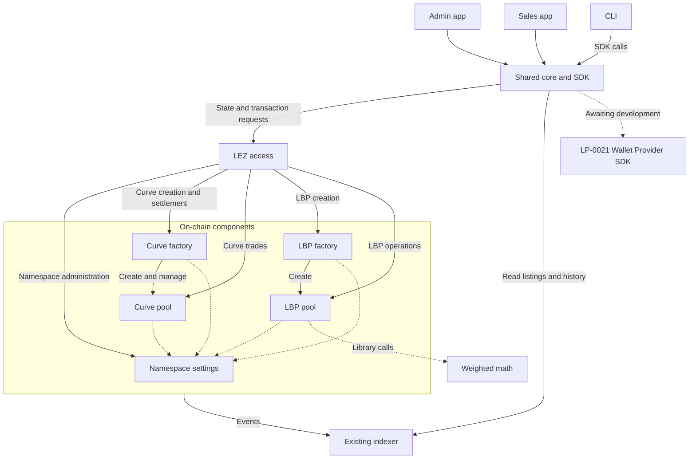

# System overview

This is the planned architecture. The production code is not built yet.

## Components

The admin app manages namespaces. Creators and participants use the sales app. Both apps read indexed data through the shared core. The CLI calls the SDK directly.

The indexer provides listings and history. Its data can lag behind the chain. Programs check current state before they accept an action. Dashed lines show dependencies or an open integration.

The curve factory can call an optional adapter saved at sale creation. A client submits separate public post-close transactions through the SDK or CLI. The adapter must initialize and claim its custody before the factory prepares destination ATAs. The hook transfers full `R` and recorded collateral due. The callback receives no factory signing rights. See the [curve contract](../product/curve-contract.md) for stages, retries, account checks and test limits. No scheduler, hook UI or live DEX integration is included.

## Flows

- [Create a curve pool](sequence-diagrams/create-curve-pool.md)
- [Create an LBP pool](sequence-diagrams/create-lbp-pool.md)
- [Make a private purchase](sequence-diagrams/private-purchase.md)

## Details

- [Factory and pool boundaries](../adr/0005-mechanism-boundaries.md)
- [Namespaces and authority](../adr/0006-namespaces-and-authority.md)
- [App packages and interfaces](../adr/0019-product-packages.md)
- [Wallet Provider SDK integration](../adr/0029-wallet-integration.md)
- [Package layout and checks](repository-layout.md)
- [Glossary](../glossary.md)
