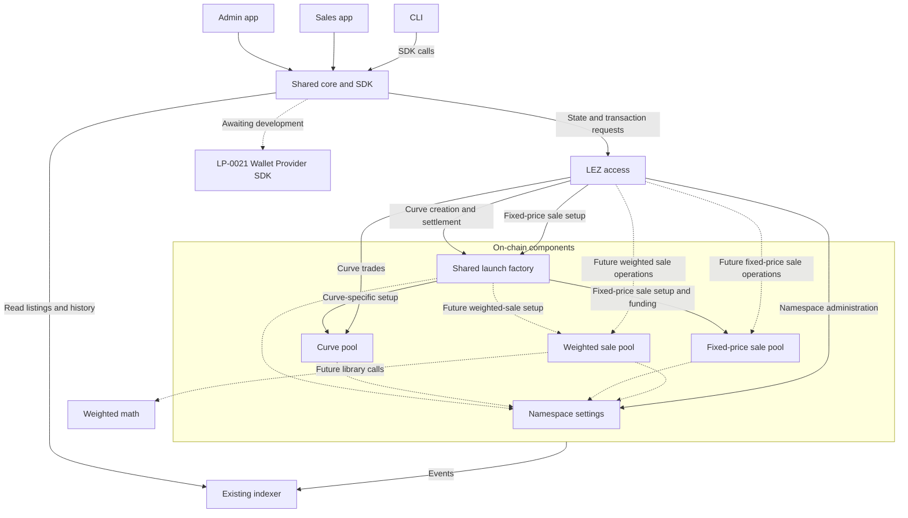

# System overview

This is the planned architecture. The full production implementation is not built. Fixed-price sale setup has a four-stage implementation that passed locked local verification using development receipts; real proofs and deployment readiness remain pending.

## Components

The admin app manages namespaces. Creators and participants use the sales app. Both apps read indexed data through the shared core. The CLI calls the SDK directly.

The indexer provides listings and history. Its data can lag behind the chain. Programs check current state before they accept an action. Dashed lines show dependencies or an open integration.

All three sale types can use a saved adapter. Its common two-asset split is required when configured; manual settlement is available only without one. The curve hook is available through the SDK or CLI. See [ADR 0020](../adr/0020-settlement-and-graduation.md) for hook policy and the [curve overview](../product/curve-contract.md#acceptance-evidence) for implementation limits.

## Flows

- [Create a curve pool](sequence-diagrams/create-curve-pool.md)
- [Create a fixed-price sale pool](sequence-diagrams/create-lbp-pool.md)
- [Make a private purchase](sequence-diagrams/private-purchase.md)

## Details

- [Factory and pool boundaries](../adr/0005-mechanism-boundaries.md)
- [Shared launch setup](../adr/0031-shared-launch-factory.md)
- [Fixed-price sale setup](../adr/0032-fixed-price-lbp-setup.md)
- [Namespaces and authority](../adr/0006-namespaces-and-authority.md)
- [App packages and interfaces](../adr/0019-product-packages.md)
- [Wallet Provider SDK integration](../adr/0029-wallet-integration.md)
- [Package layout and checks](repository-layout.md)
- [Glossary](../glossary.md)
