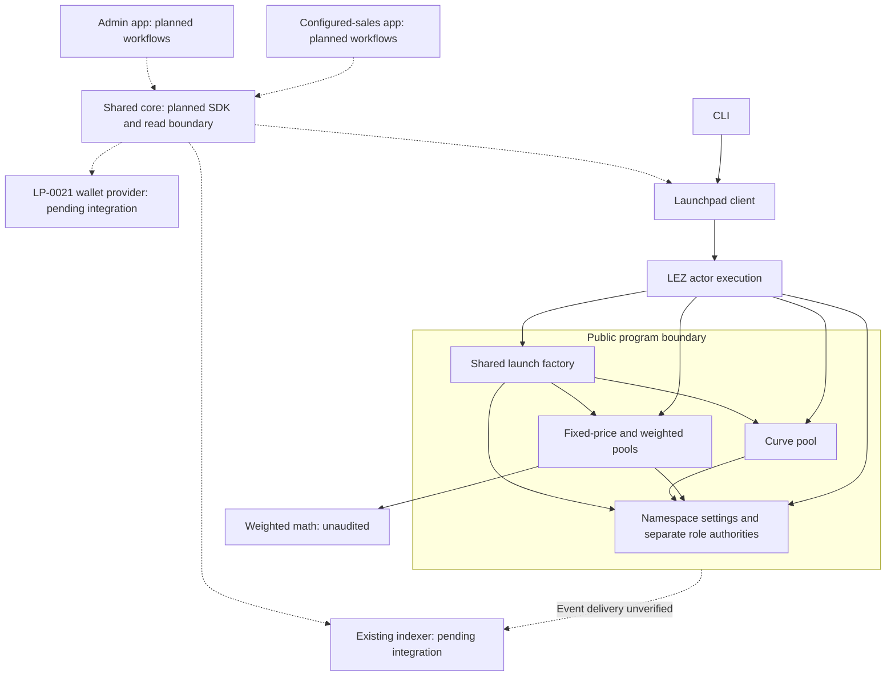

# System overview

Public setup, trading, controls, fee collection, settlement and graduation use the selected LEZ actor interface. Local checks do not establish live readiness. The QML apps and shared core are package placeholders; wallet, indexed reads and private routes remain incomplete. See [evidence limits](workspace-guide.md#execution-and-evidence-limits).

## Components

Solid lines show implemented code boundaries. Dashed lines show pending integration. The factory shares setup and policies, not pricing state or custody. Weighted trades need a [supported clock provider](workspace-guide.md#temporary-weighted-pricing-clock). A successful graduation callback does not prove DEX liquidity.

The admin app is for namespace administration. The configured-sales app is for creators and participants. Planned QML reads go through the shared-core backend module API. Indexed data can lag; programs enforce current state.

## Flows and contracts

- [Creation and private-purchase flows](sequence-diagrams/README.md)
- [Shared launch setup and policies](../adr/0031-shared-launch-factory.md)
- [Namespace and role authority](../adr/0006-namespaces-and-authority.md)
- [Settlement and graduation](../adr/0020-settlement-and-graduation.md)
- [Package responsibilities](repository-layout.md)
- [Private participation and recovery](private-participation.md)
