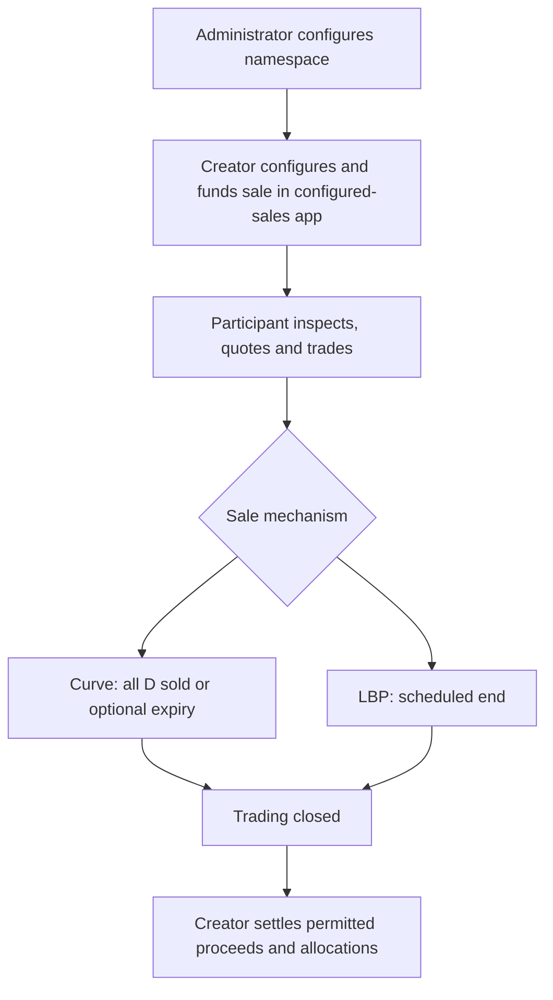

# Product goals and use cases

This brief describes the planned launchpad. It uses the terms in [CONTEXT.md](../../CONTEXT.md) and the decisions in the [ADR index](../adr/README.md). It is not a list of shipped features.

## Goal

Give creators a choice of bonding-curve or LBP sales on LEZ. Give participants clear quotes, explicit trade limits and access to sale history. Let other operators use these tools within independent namespaces, without building a separate trading client.

The product responds to [RFP-015](https://github.com/logos-co/rfp/blob/master/RFPs/RFP-015-bonding-curve-launchpad.md) and [RFP-016](https://github.com/logos-co/rfp/blob/master/RFPs/RFP-016-lbp-launchpad.md), with [curve](https://github.com/logos-co/rfp/issues/118) and [LBP](https://github.com/logos-co/rfp/issues/119) proposals. Current decisions and RFP differences are recorded in the ADRs linked below.

## Users and interfaces

The admin mini-app serves namespace administrators only. The configured-sales mini-app serves creators and participants within its configured namespace. These are separate authority roles, even when one person holds more than one role. App placement does not grant or merge rights. A non-UI shared core supports both apps. Both apps request indexed listings, history and relevant monitoring through a backend module read API, not direct indexer HTTP calls. Indexed data can lag; current chain state remains authoritative for a quote, transaction and contract execution. The CLI lets developers and operators use the same SDK logic. See [ADR 0019](../adr/0019-product-packages.md).

| Actor | Goal | Interface | Expected outcome | Rule or open detail |
| --- | --- | --- | --- | --- |
| Namespace administrator | Manage a launchpad namespace | Admin app or CLI | Change the fee rate and current treasury through separate operations; manage admin authority | AccountId administration; creator rights remain separate ([0006](../adr/0006-namespaces-and-authority.md)) |
| Creator | Create a curve sale | Configured-sales app or CLI | Submit typed curve inputs to the curve factory, fund allocations `D` and `R`, and optionally set expiry | No early close; settlement burns unsold `D` after expiry ([0025](../adr/0025-sale-closing.md)) |
| Creator | Create an LBP | Configured-sales app or CLI | Submit LBP inputs to the independent LBP factory, choose weighted or fixed-price mode, fund the sale, and set its schedule | Current creator authority alone controls pause/resume; the schedule continues. Mechanics are specified; handlers and allowlist proofs remain future work ([LBP contract](lbp-contract.md), [0021](../adr/0021-modes-and-open-limits.md), [0026](../adr/0026-lbp-clock-and-poke.md)) |
| Participant | Find a sale and trade | Configured-sales app or CLI | Inspect the sale, request a fresh quote and submit a buy with an explicit slippage limit; sell back to a curve when its mode permits | Execution uses current state; a quote does not reserve a price ([0017](../adr/0017-quotes-and-slippage.md)) |
| Participant | Use the private route | Configured-sales app or CLI through the SDK | Deshield, trade through fresh public accounts, and return received tokens, unused input and unused gas to participant-controlled private accounts in one transaction | Actual fees are excluded; public effects stay visible. Whole-route execution and wallet support remain unverified ([0018](../adr/0018-private-participation.md)) |
| Participant | Resolve an interrupted private trade | Configured-sales app or CLI through the SDK | Restore minimal local progress, reconcile the original attempt and synchronize confirmed private state | Unknown outcomes block replacement; confirmation and recovery support need provider verification ([private participation contract](../architecture/private-participation.md)) |
| Participant | Use an LBP allowlist | Public or private route | Prove membership and approved-account control, then make one successful purchase within the common public collateral limit | Routes share one allowance; roster remains private; proof construction and enforcement need verification ([0021](../adr/0021-modes-and-open-limits.md)) |
| Any caller | Collect accrued protocol fees | SDK or CLI | Transfer all accrued collateral fees to the current treasury, at any time | Caller cannot redirect funds; zero accrued fees cause no transfer ([0015](../adr/0015-fee-accounting.md), [0016](../adr/0016-lbp-live-fees.md)) |
| Creator | Settle a closed sale | Configured-sales app or CLI | Collect remaining fees atomically with the relevant reserve or proceeds transfer; complete permitted allocation payouts | Closure and settlement are separate; stages can span transactions; no automatic DEX graduation ([0020](../adr/0020-settlement-and-graduation.md)) |
| Participant or operator | Inspect history | App history or existing explorer tools | Request indexed trades and sale events through the backend module read API without exposing persistent private participant identifiers | History and monitoring remain in scope; a separate analytics view does not ([0027](../adr/0027-events-and-history.md)) |

## Sale journey

This planned journey shows user actions and sale state, not transaction or account schemas. Namespace administration does not grant the creator's withdrawal rights.

Trading can repeat while the sale is open and its mode permits it. Expiry does not depend on a participant making a final trade. Fee collection can happen before or after closure; it is not blocked on creator settlement.

See the planned [curve pool creation](../architecture/sequence-diagrams/create-curve-pool.md) and [LBP pool creation](../architecture/sequence-diagrams/create-lbp-pool.md) sequences. They show logical stages only. A curve pool retains staged creation, a pending trading guard and factory custody. The LBP sequence does not assign those curve details to LBP creation.

## Mechanism rules

| Rule | Curve | LBP |
| --- | --- | --- |
| Price | Constant-product pricing with virtual reserves and real-reserve limits | Execution-time linear weights with timestamp-keyed checkpoints, or exact rational fixed-price mode |
| Buy forms | Exact input or exact output with an explicit limit | Both forms in both modes; no partial fills or exact-input rounding refunds |
| Close | All `D` sold, or optional expiry, whichever occurs first | Original scheduled end, even while paused |
| Minimum duration | No contract minimum for optional expiry; a frontend rule is undecided | No contract minimum; require `end > start` and no past scheduled start |
| Protocol fee | Collateral deducted from buy input or sell output | Creator-borne collateral claim; full buyer input enters pricing |
| Fee collection | Permissionless, anytime, to current treasury | Permissionless, anytime, to current treasury; pricing reserves unchanged |

`R` is the curve's DEX-seed reserve. It stays untouched until close. The creator can withdraw it after close when it is not used for graduation.

## Scope limits and open work

- Private curve buys/sells and LBP buys follow the [private participation and recovery contract](../architecture/private-participation.md). Runtime implementation, full returns, late-failure behavior and safe reconciliation remain unverified. The [private purchase sequence](../architecture/sequence-diagrams/private-purchase.md) is a required route, not a working-implementation claim.
- LBP allowlist product policy is accepted: one purchase across both routes, approved-account control, one public collateral cap and a private roster. The proof method, enrollment details and compatible verifier remain open.
- Privacy warnings are required before transaction approval. Acknowledgement frequency is deferred.
- Integrate the LP-0021 Wallet Provider SDK once developed. Private-route support still needs verification; see [ADR 0029](../adr/0029-wallet-integration.md).
- The per-block allocation ceiling is deferred. Live LBP fee rates, anytime LBP collection and omission of curve contract minimum-duration validation differ from the RFPs. The relevant ADRs are marked `To be reviewed by Logos team`.
- Automatic DEX graduation is inactive. Direct neutral pools are internal primitives, not a separate sale product.
- Use the existing indexer and explorer tools. Do not add a separate indexer or the excluded derived analytics view.
- Platform compatibility, checked numerical input/error guards and private-route implementation still need evidence. The [LBP overview](lbp-contract.md) summarizes mechanics; it does not claim a working LBP program.

See the [namespace, custody, and fee contract](namespace-fee-contract.md) for shared account checks and collection rules. The [LBP overview](lbp-contract.md) summarizes its main concepts. See [architecture and interfaces](../architecture/system.md) for component responsibilities and [repository layout](../architecture/repository-layout.md) for packages and checks.
