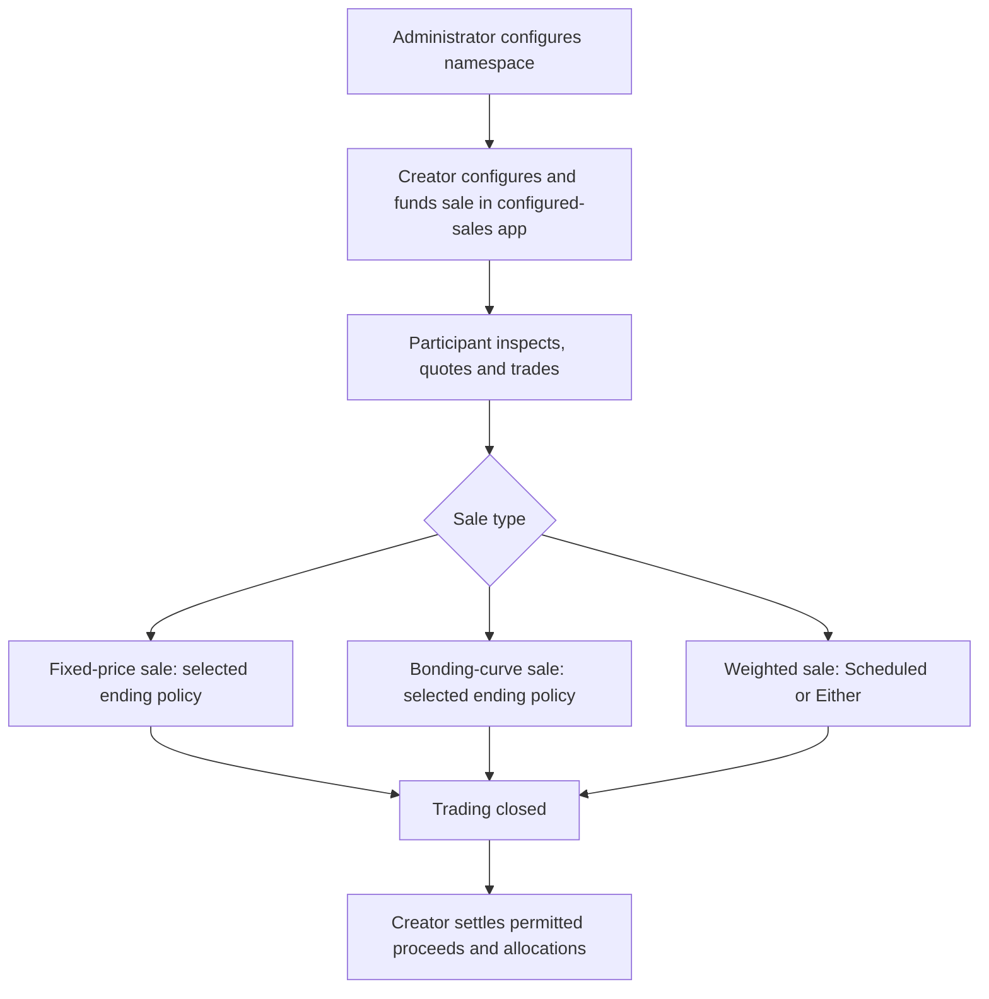

# Product goals and use cases

This brief describes the planned launchpad. It uses the terms in [CONTEXT.md](../../CONTEXT.md) and the decisions in the [ADR index](../adr/README.md). It is not a list of shipped features.

## Goal

Give creators a choice of fixed-price, bonding-curve or weighted sales on LEZ. Give participants clear quotes, explicit trade limits and access to sale history. Let other operators use these tools within independent namespaces, without building a separate trading client.

The product responds to [RFP-015](https://github.com/logos-co/rfp/blob/master/RFPs/RFP-015-bonding-curve-launchpad.md) and [RFP-016](https://github.com/logos-co/rfp/blob/master/RFPs/RFP-016-lbp-launchpad.md), with [bonding-curve](https://github.com/logos-co/rfp/issues/118) and [fixed-price and weighted sale](https://github.com/logos-co/rfp/issues/119) proposals. Current decisions and RFP differences are recorded in the ADRs linked below.

## Users and interfaces

The admin mini-app serves namespace administrators only. The configured-sales mini-app serves creators and participants within its configured namespace. These are separate authority roles, even when one person holds more than one role. App placement does not grant or merge rights. A non-UI shared core supports both apps. Both apps request indexed listings, history and relevant monitoring through a backend module read API, not direct indexer HTTP calls. Indexed data can lag; current chain state remains authoritative for a quote, transaction and contract execution. The CLI lets developers and operators use the same SDK logic. See [ADR 0019](../adr/0019-product-packages.md).

| Actor | Goal | Interface | Expected outcome | Rule or open detail |
| --- | --- | --- | --- | --- |
| Namespace administrator | Manage a launchpad namespace | Admin app or CLI | Change the fee rate and current treasury through separate operations; manage admin authority | AccountId administration; creator rights remain separate ([0006](../adr/0006-namespaces-and-authority.md)) |
| Creator | Create a fixed-price sale | Planned configured-sales app or CLI | Claim a new launch token, supply fixed-price setup inputs and fund final setup through the shared launch factory | See the [sale overview](lbp-contract.md) for implemented setup, buys, fees and creator payouts, and their execution limits |
| Creator | Create a bonding-curve sale | Configured-sales app or CLI | Choose a trade mode and ending policy, fund allocations, and optionally set an adapter | See the [bonding-curve overview](curve-contract.md) for decisions and implementation status |
| Creator | Create a weighted sale | Future configured-sales app or CLI | Configure sale inventory, scheduled weights and the sale period | Handlers have local evidence limits; normal weighted buys require a supported pricing clock ([Sale overview](lbp-contract.md), [0026](../adr/0026-lbp-clock-and-poke.md)) |
| Participant | Find a sale and trade | Configured-sales app or CLI | Inspect the sale, request a fresh quote and submit a buy with an explicit slippage limit; sell back when the sale mode permits | Execution uses current state; a quote does not reserve a price ([0017](../adr/0017-quotes-and-slippage.md)) |
| Participant | Use the private route | Configured-sales app or CLI through the SDK | Deshield, trade publicly, and return received tokens, unused input and unused gas to participant-controlled private accounts in one transaction | Prefer fresh public accounts; an allowlisted buy uses a pre-approved public trader. Actual fees are excluded and public effects stay visible. Whole-route execution and wallet support remain unverified ([0018](../adr/0018-private-participation.md)) |
| Participant | Resolve an interrupted private trade | Configured-sales app or CLI through the SDK | Restore minimal local progress, reconcile the original attempt and synchronize confirmed private state | Unknown outcomes block replacement; confirmation and recovery support need provider verification ([private participation contract](../architecture/private-participation.md)) |
| Participant | Use an optional sale allowlist in any pricing engine | Public program route; wallet and private route pending | Precompute public trading-address batches before list lock; prove membership and control of the actual approved trader for each buy | Send only addresses to the creator, without keys or private funding/return IDs. Prefer an unused approved address per attempt; approval permits repeat buys. The full roster stays private, but the used address is public. Public admission has signed development evidence; weighted tests use a mock clock and normal weighted buys remain unsupported ([0021](../adr/0021-modes-and-open-limits.md)) |
| Any caller | Collect accrued protocol fees | SDK or CLI | Transfer all accrued collateral fees to the current treasury, at any time | Caller cannot redirect funds; zero accrued fees cause no transfer. Handlers exist for all three engines; production readiness remains pending ([0015](../adr/0015-fee-accounting.md), [0016](../adr/0016-lbp-live-fees.md)) |
| Creator | Settle a closed sale manually | Configured-sales app or CLI | Collect remaining fees and permitted allocations or proceeds | Separate [fixed-price](../adr/0025-sale-closing.md) and [curve](../adr/0020-settlement-and-graduation.md) rules apply; weighted settlement has local guest checks |
| Any caller | Execute or retry a configured curve adapter hook | SDK or CLI | Submit the public post-close settlement stages | [Hook and recovery rules](../adr/0020-settlement-and-graduation.md); [implementation limits](curve-contract.md#acceptance-evidence) |
| Participant or operator | Inspect history | App history or existing explorer tools | Request indexed trades and sale events through the backend module read API without exposing persistent private participant identifiers | History and monitoring remain in scope; a separate analytics view does not ([0027](../adr/0027-events-and-history.md)) |

## Sale journey

This planned journey shows user actions and sale state, not transaction or account schemas. Namespace administration does not grant the creator's withdrawal rights.

Trading can repeat while the sale is open and its mode permits it. Expiry does not require a final trade. Fee collection does not wait for settlement. Bonding-curve sales also support the adapter route listed above.

See the planned [curve pool creation](../architecture/sequence-diagrams/create-curve-pool.md) and [implemented four-stage fixed-price sale setup](../architecture/sequence-diagrams/create-lbp-pool.md) sequences. They show logical stages only. A curve pool retains staged creation, a pending trading guard and factory custody. The fixed-price sequence defines its own setup and funding stages; locked local verification passed using development receipts, real proofs and deployment readiness remain pending, and it does not assign curve custody or lifecycle to fixed-price sale creation.

## Sale rules

These rules describe the selected sale designs. The [sale overview](lbp-contract.md) records fixed-price and weighted implementation and evidence limits.

| Rule | Fixed-price sale | Bonding-curve sale | Weighted sale |
| --- | --- | --- | --- |
| Price | Positive exact ratio in collateral and launch-token smallest units | Constant-product pricing with virtual reserves and real-reserve limits | Execution-time linear weights with timestamp-keyed checkpoints |
| Buy forms | Exact input or exact output; no partial fills or exact-input rounding refunds | Exact input or exact output with an explicit limit | Exact input or exact output; no partial fills or exact-input rounding refunds |
| Close | `Scheduled`, `Depletion` or `Either` | `Scheduled`, `Depletion` or `Either` | `Scheduled` or `Either`; schedule end required as fallback |
| Minimum duration | No contract minimum; require `end > start` and no past scheduled start | No contract minimum for optional expiry; a frontend rule is undecided | No contract minimum; require `end > start` and no past scheduled start |
| Protocol fee | Deducted before pricing; exact output grosses up required net collateral ([0035](../adr/0035-fixed-price-swap-fees.md)) | Collateral deducted from buy input or sell output | Deducted before pricing; exact output grosses up required net collateral ([0031](../adr/0031-shared-launch-factory.md)) |
| Fee collection | Permissionless, anytime, to current treasury; fixed price unchanged | Permissionless, anytime, to current treasury | Permissionless, anytime, to current treasury; pricing reserves unchanged |

Selected depletion is final. `Scheduled` ignores depletion for settlement and allocation claims; empty inventory still prevents buys. Settlement burns cannot create depletion evidence. `Manual` is direct-only. See [ADR 0025](../adr/0025-sale-closing.md). Namespace fees always use collateral buy input or sell output. Retained creator fees remain future work.

`R` is the curve's DEX-seed reserve. It stays untouched until close. The creator can withdraw it after close when it is not used for graduation.

## Scope limits and open work

- See the [sale overview](lbp-contract.md) for fixed-price setup, buy, fee and payout support. Signed guest tests cover fixed-price settlement transfers, burns and rollback. End hooks, delayed settlement, cancellation or expired-recovery handlers, live weighted clock support, private fixed-price or weighted sales, wallet allowlist flows and full SDK or CLI flows remain future work.
- Private bonding-curve buys/sells and future fixed-price and weighted sale buys follow the [private participation and recovery contract](../architecture/private-participation.md). Runtime implementation, full returns, late-failure behavior and safe reconciliation remain unverified. The [private purchase sequence](../architecture/sequence-diagrams/private-purchase.md) is a required route, not a working-implementation claim.
- Optional allowlists cover buys in all three pricing engines under [ADR 0021](../adr/0021-modes-and-open-limits.md). Its 2026-11-10 amendment replaces private-account enrollment with pre-approved public trading-address batches, while retaining private funding and complete private returns. The list is locked in the initial sale terms and cannot change during setup; capacity counts addresses, not people. Protected membership delivery happens before buying, with no per-buy creator dependency. Keys and private funding/return IDs do not go to the creator. Proving stays local, without remote key custody. The [plain-English design](../architecture/allowlist-proof.md) gives an A/B/C example; the maintained `crates/eligibility-policy` module enforces public buy admission in all three engines, with signed native `Execute` authority and replay checks. See the [integration evidence](../../plans/allowlist-program-integration.md#public-execution-evidence) for complete-public-buy measurements and limits. Wallet support and the complete private route remain pending.
- The wallet prefers an unused approved address per attempt. If none remain, it reports that limit rather than silently reusing an address or choosing an unapproved one. Deliberate reuse needs a privacy warning. The creator can link addresses submitted together, and public reuse links purchases. Fresh addresses do not guarantee unlinkability. Repeated and independent concurrent authorized buys remain allowed when native funding and current pool state permit, without an allowlist collateral cap, purchase counter or consumed allowance. Account approval does not establish human uniqueness.
- Privacy warnings are required before transaction approval. Acknowledgement frequency is deferred.
- Integrate the LP-0021 Wallet Provider SDK once developed. Private-route support still needs verification; see [ADR 0029](../adr/0029-wallet-integration.md).
- The per-block allocation ceiling is deferred. Live fixed-price and weighted sale fee rates, anytime collection and omission of curve contract minimum-duration validation differ from the RFPs. Trader-borne fixed-price fees are an additional RFP-016 departure under [ADR 0035](../adr/0035-fixed-price-swap-fees.md); [ADR 0031](../adr/0031-shared-launch-factory.md) also replaces weighted creator-borne incidence. The relevant ADRs are marked `To be reviewed by Logos team`.
- Direct neutral pools are internal primitives, not a separate sale product.
- Use the existing indexer and explorer tools. Do not add a separate indexer or the excluded derived analytics view.
- Platform compatibility, checked numerical input/error guards and private-route implementation still need evidence. The [fixed-price and weighted sale overview](lbp-contract.md) summarizes mechanics; it does not claim a complete sale program.

See the [namespace, custody, and fee contract](namespace-fee-contract.md), [system overview](../architecture/system.md) and [repository layout](../architecture/repository-layout.md) for shared rules and responsibilities.
